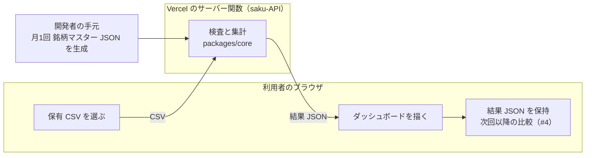

# 設計

この文書は、sakuforge の純粋関数の境界、パッケージ構成、銘柄マスター JSON の流れ、層ごとの守りの分担の設計の正本です。判断は
ADR 0003（言語は TypeScript）と ADR 0004（Vercel と Next.js、検査と集計はサーバー関数）にあり、ここでは
それを形にします。規則（上限値、所見 code、構成計算）は[ドメイン規則](domain-rules.md)を正本とし、
ここに再掲しません。上限値だけは、5 節で Vercel の上限と比べるために写します。

## 1. 全体の流れ



ブラウザは CSV をサーバー関数へ送り、関数は核で検査と集計をして結果を JSON で返します。サーバーは CSV も
結果も保存しません。銘柄マスターは関数の中だけで使い、ブラウザへ配りません（ADR 0004）。招待の確認は
ありません（[ADR 0006](decisions/0006-unlisted-public-release.md)）。

## 2. 純粋関数の境界

核（`packages/core`）は、入力だけから結果が決まり、保存・通信・時計・乱数・ログを持たない関数だけを置きます。

| | 内容 |
| --- | --- |
| 入力 | CSV のバイト列（`Uint8Array`）または decode 済みの文字列と、銘柄マスター（検証済みの値）。大きさの上限は、バイト列は byte 数、文字列は長さ（UTF-16 の符号単位の数）で数える |
| 出力 | 検査結果（`valid`、件数、所見、照合結果）と集計結果。検査結果の形と構成計算の規則は[ドメイン規則](domain-rules.md)の6・7節。集計結果の項目は ADR 0005 の「流れ」の3、JSON の形は[8](#8-要求応答保存する-json-の形) |
| 10進 | 金額・株数・構成比は文字列で受け渡し、核の中でも2進浮動小数点（`number`）で計算しない |
| 例外 | 利用者向けの結果は固定 code と固定 message だけにする。例外の文字列を結果に入れない（[入力を信用しない原則](input-trust-principles.md)） |

decode（UTF-8 と CP932）は核の中に置きます。`TextDecoder` は Node.js にもブラウザにもある標準の機能で、
副作用を持たないので、核のテストで文字コードの規則まで確かめられます。核をブラウザ側へ移す保険の案
（ADR 0004 の「検討した他の案」）でも、そのまま動きます。

核の外（`apps/web` のサーバー関数）に残るもの:

- リクエストの受け取りと、サイズ上限+1 byte までの読み込み
- 実行時間の上限。独自の時計は持たず、関数全体の `maxDuration` に任せる（[5](#5-vercel-の関数で処理するときの上限)）
- 銘柄マスター JSON の読み込みと検証（[外部データとの約束](external-data-policy.md)）
- 結果 JSON への変換と、出典・基準日の付加
- ログに内容を出さないこと（成否、件数、処理時間、固定 code だけ）

## 3. パッケージ構成

pnpm workspace は次の2つのパッケージで構成します。

| パッケージ | 中身 | 依存してよいもの |
| --- | --- | --- |
| `@sakuforge/core`（`packages/core`） | CSV の検査、集計、型 | 10進演算と入力検証の最小限の依存だけ。React、Next.js、実行環境固有の API に依存しない |
| `@sakuforge/web`（`apps/web`） | Next.js（App Router）の画面と、サーバー関数（検査と集計） | `@sakuforge/core` |

銘柄マスター JSON を生成する手元の道具をリポジトリに置くかどうかは、実装の PR で決めます。置く場合も
生成物は `.gitignore` の `data/stock-master/` に出し、リポジトリに入れません。

## 4. 銘柄マスター JSON の流れ

1. 月1回、手元で東証の月次 Excel を取得・検証し、必要な列だけの JSON を生成する（[外部データとの約束](external-data-policy.md)の2節）
2. 生成物はリポジトリの外に置く（[ADR 0002](decisions/0002-public-repository.md)）
3. サーバー関数がそれを読み、照合と集計に使う。ブラウザへは配らない。関数へどう置くか（配備物に含めるか、
   Vercel の外部の保存先から読むか）は実装の前に決める。利用範囲の確認は #3
4. 関数は読み込んだ JSON を信用せず、形式と件数を検証してから核へ渡す

## 5. Vercel の関数で処理するときの上限

値は[ドメイン規則](domain-rules.md)の1節が正本で、ここでは決めません。Vercel の関数で
処理すると、ドメイン規則の上限の前に、Vercel 側の上限がかかります。現行の値は #20 で確かめます。

| 上限 | 気にすること |
| --- | --- |
| サイズ 4 MiB、上限+1 byte まで読む | Vercel の関数の本文上限は公式資料で 4.5 MB（2026-11-01 確認、#20）。本文は CSV だけなので（[8.1](#81-要求)）、4 MiB+1 byte まで読んでも収まる。これより大きい本文は関数に届く前に 413 になるので、画面で処理する。送信の実測で扱えなければ、ブラウザで検査する案（ADR 0004 の保険の案）に切り替える |
| データ行 10,000、列 100 | 関数の memory と実行時間の中に収まるか（#20） |
| 検査時間：関数全体の `maxDuration` | 独自の時計を持たない（同期の核は途中で止められないため）。値は Vercel 上の実測で決める（#20）。超えたら Vercel のエラー（504）になり、画面は失敗として扱う |
| 所見 200 件、未知コードは全件（PR #22） | 応答 JSON の大きさを抑える。レスポンス本文にも 4.5 MB の上限がある（#20） |
| ファイル名、MIME タイプ | ファイル名はサーバーへ送らない。`Content-Type` は画面が固定で付ける値で、信用せず、内容検証の代わりにしない（[8.1](#81-要求)）。どちらもログに出さない |
| ログと監視 | CSV の内容、資産値、ファイル名を、関数のログ、エラー、Vercel の監視に出さない（[入力を信用しない原則](input-trust-principles.md)の3節） |

## 6. ブラウザ側の結果と履歴

ブラウザは返ってきた結果 JSON からダッシュボードを描き、次回以降の比較のために保持します。JSON の形は[8](#8-要求応答保存する-json-の形)、
保存の場所と比較（時系列の総資産など）は #4 で決めます。比較は最初の範囲には含めません（ADR 0005）。

## 7. 層ごとの守りの分担

守る対象ごとに、どの層が主に受け持ち、どの層が安全網になるかを決めます（#48、2026-11-07）。ここには
受け持ちだけを書き、規則の中身は右端の正本に書きます。「—」の層は、その対象を受け持ちません。

| 守る対象 | Vercel（基盤） | サーバー関数 | 核（`packages/core`） | 画面 | 開発者（生成・配備・運用） | 規則の正本 |
| --- | --- | --- | --- | --- | --- | --- |
| 1. 要求が続くことによる資源・無料枠の枯渇 | 主：基盤の DDoS 対策と、検査 API への WAF のレート制限 | — | — | — | 安全網：使用量を確かめる手順と、手で止める・戻す手順 | — |
| 2. 1 回の要求による時間・メモリの使いすぎ | 安全網：本文 4.5 MB 超の 413、`maxDuration`、メモリの上限 | 主：上限+1 byte までしか読まず、核へバイト列で渡す | 主：処理量を入力の長さより膨らませず、行・列・所見の上限で止める。時計は持たない | — | 安全網：`maxDuration` の値を実測で決めて設定する（#20） | [ドメイン規則](domain-rules.md)の1節、[入力を信用しない原則](input-trust-principles.md)の2節 |
| 3. 利用者データ・秘密・銘柄マスターの意図しない保存・流出 | — | 主：CSV と結果を残さず、ログは安全な項目だけにし、応答に `Cache-Control: no-store` を付け、銘柄マスターを応答に含めない | 主：戻り値に保有明細・セルの値・CSV の原文・例外の文言を含めない | 主：結果を外部へ送らず、ファイル名をサーバーへ送らない | 安全網：秘密と銘柄マスターをリポジトリと配布物に入れず、配備のときに残るものを確かめる | [入力を信用しない原則](input-trust-principles.md)の3節、[外部データとの約束](external-data-policy.md)の4節 |
| 4. 壊れた銘柄マスターや基準日の取り違えによる誤分類 | — | 主：読み込んだ JSON を検証してから核へ渡し、壊れていれば固定の code で拒否する | 安全網：不正な銘柄マスターでは集計を拒否する | 安全網：出典と基準日を表示する | 主：生成のときに検証し、失敗したら配備しない | [外部データとの約束](external-data-policy.md)の2節・3節、[4](#4-銘柄マスター-json-の流れ) |
| 5. 不正・途中の結果を、正しい集計として表示すること | — | 主：集計は成功したときだけ返し、拒否は固定の code で返す | 主：error が 1 つでもあれば集計しない | 主：完全に成功した応答だけを反映し、413・504・形の合わない応答・通信の切断では表示しない | — | [入力を信用しない原則](input-trust-principles.md)の2節、[ドメイン規則](domain-rules.md)の6節 |
| 6. 外部由来の文字列が画面でコードとして動くこと | — | 安全網：JSON で返し、CSV のセルの値を含めない | — | 主：文字として描画する。安全網：Content-Security-Policy | 安全網：銘柄マスターの名前の文字数と制御文字を検証する | [入力を信用しない原則](input-trust-principles.md)の1節・3節 |

- 1 は、枯渇を軽減し、それでも残る停止は無料のあいだ受け入れる（有料化するとき、または実行環境に課金し始めるときに見直す）。
  独自のレート制限と、そのための保存先は作らない
- 3 で、利用者の環境（ブラウザの拡張機能、端末の共用、ブラウザの同期）は利用者の責務で、どの層も受け持たない
- Vercel の WAF・Pause Project の使える範囲と、ログ・環境変数に残るものは、配備（#44）のときに確かめる
- CSV Formula Injection は 6 に含めない。セルの値を出力する機能を足すときに扱う（[入力を信用しない原則](input-trust-principles.md)の5節）

## 8. 要求・応答・保存する JSON の形

検査 API の要求と応答、ブラウザに保存する JSON の形を決めます（#21、2026-11-11）。核の戻り値はそのまま
流さず、サーバー関数で組み直します（[2](#2-純粋関数の境界)の「結果 JSON への変換」）。例の値はすべて合成データです。

### 8.1 要求

- `POST /api/inspect`。本文は CSV のバイト列だけにする。multipart にしない
- `Content-Type` は `text/csv`（`application/vnd.ms-excel` も受ける）。画面が固定で付ける。ブラウザが
  ファイルに付ける種類は端末に依るので、使わない
- ファイル名は送らない（[7](#7-層ごとの守りの分担)の 3 行目）。ファイル名の規則（[ドメイン規則](domain-rules.md)の1節）は、
  画面がファイルを選ばせるときに確かめる

### 8.2 応答（検査まで進んだとき、HTTP 200）

```json
{
  "schemaVersion": 1,
  "result": "aggregated",
  "inspection": {
    "valid": true,
    "profile": "domestic_cash_holdings_v1",
    "encoding": "utf-8",
    "rowsScanned": 3,
    "findings": [
      {
        "code": "stock_code_unknown",
        "severity": "warning",
        "message": "銘柄マスターに無い証券コードがあります。該当銘柄は「未分類」として集計しました。"
      }
    ],
    "errorCount": 0,
    "warningCount": 1,
    "totalCount": 1,
    "returnedCount": 1,
    "truncated": false,
    "stockCodeMatch": { "status": "checked", "unknownCodes": ["9D9D"], "unknownCount": 1 }
  },
  "aggregation": {
    "totalAssetValue": "128100",
    "annualDividend": { "lower": "4011", "upper": "5011" },
    "sector17": {
      "status": "computed",
      "sectors": [
        { "code": "1", "name": "合成業種1", "ratio": "93.68" },
        { "code": "2", "name": "合成業種2", "ratio": "6.25" },
        { "code": null, "name": null, "ratio": "0.08" }
      ]
    },
    "sector33": {
      "status": "computed",
      "sectors": [
        { "code": "1", "name": "合成業種1", "ratio": "93.68" },
        { "code": "2", "name": "合成業種2", "ratio": "6.25" },
        { "code": null, "name": null, "ratio": "0.08" }
      ]
    }
  },
  "stockMaster": { "source": "株式会社東京証券取引所「東証上場銘柄一覧」", "asOf": "2026-10-31" }
}
```

| 項目 | 内容 |
| --- | --- |
| `schemaVersion` | 応答の版（[8.6](#86-版)） |
| `result` | `aggregated`（検査 OK。`aggregation` がある）または `inspection_failed`（検査 NG。`aggregation` が無い） |
| `inspection` | 検査結果。項目は[ドメイン規則](domain-rules.md)の6節。位置を持つ所見には `row`、`column`、`field` が付く。`stockCodeMatch.status` は `checked` または `not_checked`（`not_checked` のときは一覧と総数が無い） |
| `aggregation` | 集計結果。規則は[ドメイン規則](domain-rules.md)の7・8節 |
| `stockMaster` | 銘柄マスターの出典（`source`）と基準日（`asOf`）。HTTP 200 の応答に常に付ける。未知の証券コードの一覧も銘柄マスター由来の情報なので、検査 NG のときも要る（[外部データとの約束](external-data-policy.md)の3節） |

- 合計が 0 のときは `aggregated` のまま、`sector17`・`sector33` が `{ "status": "not_computable", "sectors": [] }` に
  なる。検査 NG と区別できる
- 未分類は `code` と `name` が `null`。表示名は画面で付ける
- 核の内部の印（`kind`）は応答に入れない

### 8.3 応答（検査へ進めなかったとき、HTTP 4xx・5xx）

```json
{ "schemaVersion": 1, "error": { "code": "csv_too_large", "message": "CSVが大きすぎます。4 MiB以下のファイルを選んでください。" } }
```

| code | HTTP | 意味 |
| --- | --- | --- |
| `request_body_unreadable` | 400 | 本文を読み取れなかった |
| `csv_too_large` | 413 | 4 MiB を超えた |
| `unsupported_media_type` | 415 | `Content-Type` が受け付ける値でない |
| `csv_too_many_rows` | 422 | データ行が上限を超えた |
| `csv_too_many_columns` | 422 | 列が上限を超えた |
| `internal_error` | 500 | それ以外。壊れた銘柄マスター（核の `invalid_stock_master`）もここにまとめる（利用者に直せないため） |

- message は固定の文言で、例外の文字列、セルの値、ファイル名を含めない
- Vercel が返す 413・504 などは JSON とは限らない。画面は、HTTP 200 で形の合う応答だけを結果として扱う
  （[7](#7-層ごとの守りの分担)の 5 行目）
- すべての応答に `Cache-Control: no-store` を付ける

### 8.4 値の型と桁

| 値 | 形 |
| --- | --- |
| 金額（`totalAssetValue`、`annualDividend.lower`・`upper`） | 丸めない 10 進の文字列。指数表記にしない。末尾のゼロは付けない。最大で整数部 24 桁・小数 8 桁 |
| 構成比（`ratio`） | 小数 2 桁の文字列（`"0.00"`、`"100.00"`） |
| 件数、行番号、列番号 | JSON の数値（整数） |
| 基準日（`asOf`） | `YYYY-MM-DD` の文字列 |

画面の表示では、金額を円未満で四捨五入（half up）し、3 桁区切りにします。文字列のまま処理し、`number` に
変換しません。JSON の値は丸めません。

### 8.5 ブラウザに保存する JSON

```json
{
  "schemaVersion": 1,
  "savedAt": "2026-11-11T09:00:00.000Z",
  "aggregation": {
    "totalAssetValue": "128100",
    "annualDividend": { "lower": "4011", "upper": "5011" },
    "sector17": { "status": "computed", "sectors": [{ "code": "1", "name": "合成業種1", "ratio": "100.00" }] },
    "sector33": { "status": "computed", "sectors": [{ "code": "1", "name": "合成業種1", "ratio": "100.00" }] }
  },
  "stockMaster": { "source": "株式会社東京証券取引所「東証上場銘柄一覧」", "asOf": "2026-10-31" },
  "summary": { "rowsScanned": 3, "unknownCount": 1 }
}
```

- 保存するのは、グラフと数字を描くのに要る集計結果だけにする。`aggregated` の結果だけを保存し、検査 NG は
  保存しない
- `aggregation` と `stockMaster` は応答と同じ形
- `summary` は件数だけを持つ（走査した行数と、未知の証券コードの数）
- `savedAt` はブラウザの時計で付ける取り込み日時。CSV の価格がいつの値かは CSV から分からないので、
  「取り込み日時」としてだけ表示する
- 入れないもの：保有明細（API が返さないので、ブラウザは持てない）、所見、未知の証券コードの一覧、ファイル名
- 保存の場所・件数・消し方は #67、保存した結果どうしの比較は #4 で決める

### 8.6 版

- `schemaVersion` は整数で、応答と保存する JSON の両方に付ける。今は 1
- 保存した JSON を読むとき、知らない版と形の合わないものは表示に使わず、消さない
- 版を上げるときは、古い版を読み替える処理を足す
