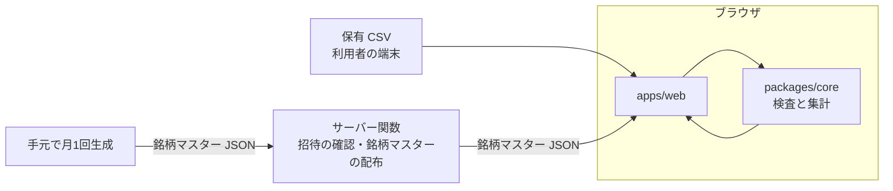

# 設計

この文書は、sakuforge の純粋関数の境界、パッケージ構成、銘柄マスター JSON の流れの設計です。判断は
ADR 0003（言語は TypeScript）と ADR 0004（Vercel と Next.js、検査はブラウザ側）にあり、ここでは
それを形にする案を書きます。規則（上限値、所見 code、構成計算）は[ドメイン規則](domain-rules.md)を正本とし、
ここに再掲しません。名前や構成は案で、実装の PR で確定します。

## 1. 全体の流れ

CSV はブラウザの外へ出ません。サーバー関数が受け取るのは招待の確認に要る値だけです（ADR 0004）。

## 2. 純粋関数の境界

核（`packages/core`）は、入力だけから結果が決まり、保存・通信・時計・乱数・ログを持たない関数だけを置きます。

| | 内容 |
| --- | --- |
| 入力 | CSV のバイト列（`Uint8Array`）または decode 済みの文字列と、銘柄マスター（検証済みの値） |
| 出力 | 検査結果（`valid`、件数、所見、照合結果）と17業種の構成。形と規則は[ドメイン規則](domain-rules.md)の6・7節 |
| 10進 | 金額・株数・構成比は文字列で受け渡し、核の中でも2進浮動小数点（`number`）で計算しない |
| 例外 | 利用者向けの結果は固定 code と固定 message だけにする。例外の文字列を結果に入れない（[入力を信用しない原則](input-trust-principles.md)） |

decode（UTF-8 と CP932）は核の中に置く案です。`TextDecoder` はブラウザと Node.js の両方にある標準の
機能で、副作用を持たないので、核のテストで文字コードの規則まで確かめられます。

核の外（`apps/web`）に残るもの:

- ファイルの受け取りと、サイズ上限+1 byte までの読み込み
- 検査時間の上限（時計を使うので核の外。Web Worker で動かし、時間を超えたら止める案）
- 銘柄マスター JSON の取得と検証（[外部データとの約束](external-data-policy.md)）
- 画面への表示と、出典・基準日の表示

## 3. パッケージ構成の案

pnpm workspace で2つに分けます。

| パッケージ | 中身 | 依存してよいもの |
| --- | --- | --- |
| `packages/core` | CSV の検査、17業種の集計、型 | 10進演算と入力検証の最小限の依存だけ。React、Next.js、ブラウザ固有の API に依存しない |
| `apps/web` | Next.js（App Router）の画面と、サーバー関数（招待の確認、銘柄マスターの配布） | `packages/core` |

銘柄マスター JSON を生成する手元の道具をリポジトリに置くかどうかは、実装の PR で決めます。置く場合も
生成物は `.gitignore` の `data/stock-master/` に出し、リポジトリに入れません。

## 4. 銘柄マスター JSON の流れ

1. 月1回、手元で東証の月次 Excel を取得・検証し、必要な列だけの JSON を生成する（[外部データとの約束](external-data-policy.md)の2節）
2. 生成物はリポジトリの外に置く（[ADR 0002](decisions/0002-public-repository.md)）
3. Vercel のサーバー関数で返すか、静的に配信して、ブラウザへ渡す。**どこまで配ってよいか（配布境界）と、
   関数か静的配信かは #3 の結果待ち**
4. ブラウザは受け取った JSON を信用せず、形式と件数を検証してから核へ渡す

ブラウザで照合する以上、照合に要る範囲の銘柄マスターは利用者の端末へ渡ります。#3 の結果で渡せない
範囲があれば、ADR 0004 の見直す条件に当たります。

## 5. ブラウザ側で動かすと意味が変わる上限

値は[ドメイン規則](domain-rules.md)の1節が正本で、ここでは決めません（#8・#9 で決める）。ブラウザで
動かすと、上限が守るものがサーバーの資源から利用者の端末の資源に変わります。

| 上限 | サーバーで動かす場合 | ブラウザで動かす場合に変わること |
| --- | --- | --- |
| サイズ 10 MiB、上限+1 byte まで読む | 受信と memory を守る | 利用者の tab の memory を守る。`File.slice` で先頭だけ読める |
| データ行 10,000、列 100 | 処理時間と memory を守る | 同じ。ただし守る相手は利用者の端末 |
| 検査時間 5 秒 | サーバーの時計で測り、結果が端末に依らない | 端末の速さで結果が変わり、同じ CSV が端末によって通ったり拒否されたりし得る |
| 所見 200 件、未知コード 50 件 | 応答の大きさを守る | 通信は無い。画面の大きさと、端末をまたいで同じ結果にすることのために残す |
| ファイル名、MIME タイプ | 利用者が送る値で信用しない | ブラウザが示す値で、やはり信用しない。サーバーへは送らない |
| 改ざん | 検査はサーバーの境界 | 利用者は自分のブラウザのコードを変えられる。検査は利用者自身のための確認で、サーバーの境界ではない。サーバー関数は自分の入力を別に検証する |

## 6. ブラウザ側の履歴

取り込み時点同士の比較はブラウザ側の履歴で行います（ADR 0001 の価値の順番2）。保存の形式と場所は #4 で
決め、最初の範囲には含めません。
