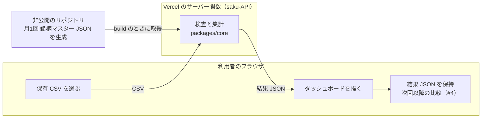
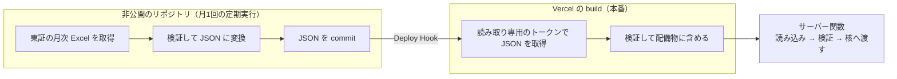

# 設計

この文書は、sakuforge の純粋関数の境界、パッケージ構成、銘柄マスター JSON の流れ、層ごとの守りの分担の設計の正本です。判断は
ADR 0003（言語は TypeScript）と ADR 0004（Vercel と Next.js、検査と集計はサーバー関数）にあり、ここでは
それを形にします。規則（上限値、所見 code、構成計算）は[ドメイン規則](domain-rules.md)を正本とし、
ここに再掲しません。上限値だけは、5 節で Vercel の上限と比べるために写します。

## 1. 全体の流れ



ブラウザは CSV をサーバー関数へ送り、関数は核で検査と集計をして結果を JSON で返します。サーバーは CSV も
結果も保存しません。銘柄マスターは関数の中だけで使い、ブラウザへ配りません（ADR 0004）。招待の確認は
ありません（[ADR 0006](decisions/0006-unlisted-public-release.md)）。

## 2. 純粋関数の境界

核（`packages/core`）は、入力だけから結果が決まり、保存・通信・時計・乱数・ログを持たない関数だけを置きます。

| | 内容 |
| --- | --- |
| 入力 | CSV のバイト列（`Uint8Array`）または decode 済みの文字列と、銘柄マスター（検証済みの値）。大きさの上限は、バイト列は byte 数、文字列は長さ（UTF-16 の符号単位の数）で数える |
| 出力 | 検査結果（`valid`、件数、所見、照合結果）と集計結果。検査結果の形と構成計算の規則は[ドメイン規則](domain-rules.md)の6・7節。集計結果の項目は ADR 0005 の「流れ」の3、JSON の形は #21 |
| 10進 | 金額・株数・構成比は文字列で受け渡し、核の中でも2進浮動小数点（`number`）で計算しない |
| 例外 | 利用者向けの結果は固定 code と固定 message だけにする。例外の文字列を結果に入れない（[入力を信用しない原則](input-trust-principles.md)） |

decode（UTF-8 と CP932）は核の中に置きます。`TextDecoder` は Node.js にもブラウザにもある標準の機能で、
副作用を持たないので、核のテストで文字コードの規則まで確かめられます。核をブラウザ側へ移す保険の案
（ADR 0004 の「検討した他の案」）でも、そのまま動きます。

核の外（`apps/web` のサーバー関数）に残るもの:

- リクエストの受け取りと、サイズ上限+1 byte までの読み込み
- 実行時間の上限。独自の時計は持たず、関数全体の `maxDuration` に任せる（[5](#5-vercel-の関数で処理するときの上限)）
- 銘柄マスター JSON の読み込みと検証（[外部データとの約束](external-data-policy.md)）
- 結果 JSON への変換と、出典・基準日の付加
- ログに内容を出さないこと（成否、件数、処理時間、固定 code だけ）

## 3. パッケージ構成

pnpm workspace は次の2つのパッケージで構成します。

| パッケージ | 中身 | 依存してよいもの |
| --- | --- | --- |
| `@sakuforge/core`（`packages/core`） | CSV の検査、集計、型 | 10進演算と入力検証の最小限の依存だけ。React、Next.js、実行環境固有の API に依存しない |
| `@sakuforge/web`（`apps/web`） | Next.js（App Router）の画面と、サーバー関数（検査と集計） | `@sakuforge/core` |

銘柄マスター JSON を生成する道具（取得と変換のスクリプト、定期実行の設定）は、非公開のリポジトリに置き、
このリポジトリには置きません（[4](#4-銘柄マスター-json-の流れ)）。東証の Excel を読む依存を、公開するアプリの
lockfile に入れないためです。`.gitignore` の `data/stock-master/` は、build のときに取得した JSON の置き場で、
リポジトリに入れません。

## 4. 銘柄マスター JSON の流れ

本物の銘柄マスターを用意して配備物に含めるまでの計画です（#66、2026-11-11）。JSON は配備物に含め、
実行時に DB や外部の保存先を読みません。例の値はすべて合成データです。

### 4.1 流れ



1. 月1回、非公開のリポジトリの定期実行が、東証の月次 Excel を取得・検証し、必要な列だけの JSON を生成して
   commit する（[外部データとの約束](external-data-policy.md)の2節）。続けて Vercel の Deploy Hook を呼ぶ
2. Vercel の build は、始める前に読み取り専用のトークンで非公開のリポジトリから JSON を取り、検証してから
   配備物に含める
3. サーバー関数は、配備物の JSON を読み、信用せずに検証してから核へ渡す。ブラウザへは配らない
   （[ADR 0004](decisions/0004-vercel-nextjs-server-side.md)）

JSON と生成の道具は非公開のリポジトリに置き、このリポジトリには置きません（[ADR 0002](decisions/0002-public-repository.md)）。
非公開のリポジトリの名前と URL は、文書・Issue・PR に書きません。元の Excel は保存せず、変換したら捨てます。

### 4.2 JSON の項目

```json
{
  "schemaVersion": 1,
  "asOf": "2026-10-31",
  "fetchedAt": "2026-11-05T00:00:00Z",
  "sourceSha256": "0000000000000000000000000000000000000000000000000000000000000000",
  "stocks": [
    {
      "code": "9A9A",
      "sector17": { "code": "1", "name": "合成業種1" },
      "sector33": { "code": "50", "name": "合成業種50" }
    },
    { "code": "9C9C", "sector17": null, "sector33": null }
  ]
}
```

| 項目 | 内容 |
| --- | --- |
| `schemaVersion` | JSON の版。整数。今は 1 |
| `asOf` | 基準日。月末の日付（`YYYY-MM-DD`）。取得日時と分けて持つ |
| `fetchedAt` | 取得日時 |
| `sourceSha256` | 元の Excel の SHA-256。Excel を保存しない代わりに、どのファイルから作ったかを残す |
| `stocks` | 銘柄ごとの 証券コード、17 業種の code と name、33 業種の code と name。業種が無い銘柄は `null` |

- 会社名は入れない。照合と構成計算に要る項目だけにする（[外部データとの約束](external-data-policy.md)の2節）
- 33 業種の code は、東証の一覧の値を、先頭にゼロを足さず数字の文字列で持つ（`"50"`、`"1050"`）。核は数値として
  並べるので、表記で結果は変わらない
- `stocks` は配列にする。証券コードを key にした object は、同じ key が重なっても読み込みで気づけないため
- 応答に付ける出典と基準日（#21 で決める `stockMaster`）は、この `asOf` から作る

### 4.3 検証

生成のとき（非公開のリポジトリ）と、読み込むとき（build とサーバー関数）の両方で、同じ項目を確かめます。

- 版が知っている値である
- 件数が下限と上限の中にある
- 証券コードが[ドメイン規則](domain-rules.md)の3節の形式で、重複が無い
- 17 業種の code が 1〜17、33 業種の code が 1〜4 桁の数字で 33 種類以内
- 同じ code には同じ name が付いている
- name が文字数の上限以内で、制御文字を含まない
- 基準日が実在する過去の日付である

件数の下限と上限、name の文字数の上限の値は、実装のときに決めます。

### 4.4 失敗したときの動き

| 場所 | 失敗したとき | 残るもの |
| --- | --- | --- |
| 生成（非公開のリポジトリ） | JSON を置かず、Deploy Hook も呼ばない。定期実行の失敗の通知で気づく | 前の JSON と前の配備 |
| build（Vercel） | 取得か検証に失敗したら、build を失敗させる | 前の配備 |
| サーバー関数 | 固定の code（`internal_error`）で拒否する。集計を返さない | — |

基準日が古くても止めません。画面に出典と基準日を表示します。古さを理由に止めると、東証の公開が遅れた月に
使えなくなるためです。

### 4.5 環境ごとの銘柄マスター

| 環境 | 銘柄マスター |
| --- | --- |
| 本番（Vercel の Production） | 本物 |
| Preview、手元、CI | 合成（`apps/web/src/server/synthetic-stock-master.ts`）。本物を渡さない |

### 4.6 秘密

- 非公開のリポジトリを読むトークンは、Vercel の環境変数に置く。1 つのリポジトリの内容を読むだけに絞る
- Deploy Hook の URL は、非公開のリポジトリの secret に置く
- どちらも、リポジトリ・ログ・Issue・PR に書かない。期限と入れ替えの手順は、配備の運用手順に書く（#44 の「3. 載せる」）

## 5. Vercel の関数で処理するときの上限

値は[ドメイン規則](domain-rules.md)の1節が正本で、ここでは決めません。Vercel の関数で
処理すると、ドメイン規則の上限の前に、Vercel 側の上限がかかります。現行の値は #20 で確かめます。

| 上限 | 気にすること |
| --- | --- |
| サイズ 4 MiB、上限+1 byte まで読む | Vercel の関数の本文上限は公式資料で 4.5 MB（2026-11-01 確認、#20）。4 MiB+1 byte の CSV に multipart の付加分を足しても収まる値にした。これより大きい本文は関数に届く前に 413 になるので、画面で処理する。送信の実測で扱えなければ、ブラウザで検査する案（ADR 0004 の保険の案）に切り替える |
| データ行 10,000、列 100 | 関数の memory と実行時間の中に収まるか（#20） |
| 検査時間：関数全体の `maxDuration` | 独自の時計を持たない（同期の核は途中で止められないため）。値は Vercel 上の実測で決める（#20）。超えたら Vercel のエラー（504）になり、画面は失敗として扱う |
| 所見 200 件、未知コードは全件（PR #22） | 応答 JSON の大きさを抑える。レスポンス本文にも 4.5 MB の上限がある（#20） |
| ファイル名、MIME タイプ | ブラウザが送る値で信用しない。ログに出さない |
| ログと監視 | CSV の内容、資産値、ファイル名を、関数のログ、エラー、Vercel の監視に出さない（[入力を信用しない原則](input-trust-principles.md)の3節） |

## 6. ブラウザ側の結果と履歴

ブラウザは返ってきた結果 JSON からダッシュボードを描き、次回以降の比較のために保持します。JSON の形は #21、
保存の場所と比較（時系列の総資産など）は #4 で決めます。比較は最初の範囲には含めません（ADR 0005）。

## 7. 層ごとの守りの分担

守る対象ごとに、どの層が主に受け持ち、どの層が安全網になるかを決めます（#48、2026-11-07）。ここには
受け持ちだけを書き、規則の中身は右端の正本に書きます。「—」の層は、その対象を受け持ちません。

| 守る対象 | Vercel（基盤） | サーバー関数 | 核（`packages/core`） | 画面 | 開発者（生成・配備・運用） | 規則の正本 |
| --- | --- | --- | --- | --- | --- | --- |
| 1. 要求が続くことによる資源・無料枠の枯渇 | 主：基盤の DDoS 対策と、検査 API への WAF のレート制限 | — | — | — | 安全網：使用量を確かめる手順と、手で止める・戻す手順 | — |
| 2. 1 回の要求による時間・メモリの使いすぎ | 安全網：本文 4.5 MB 超の 413、`maxDuration`、メモリの上限 | 主：上限+1 byte までしか読まず、核へバイト列で渡す | 主：処理量を入力の長さより膨らませず、行・列・所見の上限で止める。時計は持たない | — | 安全網：`maxDuration` の値を実測で決めて設定する（#20） | [ドメイン規則](domain-rules.md)の1節、[入力を信用しない原則](input-trust-principles.md)の2節 |
| 3. 利用者データ・秘密・銘柄マスターの意図しない保存・流出 | — | 主：CSV と結果を残さず、ログは安全な項目だけにし、応答に `Cache-Control: no-store` を付け、銘柄マスターを応答に含めない | 主：戻り値に保有明細・セルの値・CSV の原文・例外の文言を含めない | 主：結果を外部へ送らず、ファイル名をサーバーへ送らない | 安全網：秘密と銘柄マスターをリポジトリと配布物に入れず、配備のときに残るものを確かめる | [入力を信用しない原則](input-trust-principles.md)の3節、[外部データとの約束](external-data-policy.md)の4節 |
| 4. 壊れた銘柄マスターや基準日の取り違えによる誤分類 | — | 主：読み込んだ JSON を検証してから核へ渡し、壊れていれば固定の code で拒否する | 安全網：不正な銘柄マスターでは集計を拒否する | 安全網：出典と基準日を表示する | 主：生成のときと build のときに検証し、失敗したら配備しない | [外部データとの約束](external-data-policy.md)の2節・3節、[4](#4-銘柄マスター-json-の流れ) |
| 5. 不正・途中の結果を、正しい集計として表示すること | — | 主：集計は成功したときだけ返し、拒否は固定の code で返す | 主：error が 1 つでもあれば集計しない | 主：完全に成功した応答だけを反映し、413・504・形の合わない応答・通信の切断では表示しない | — | [入力を信用しない原則](input-trust-principles.md)の2節、[ドメイン規則](domain-rules.md)の6節 |
| 6. 外部由来の文字列が画面でコードとして動くこと | — | 安全網：JSON で返し、CSV のセルの値を含めない | — | 主：文字として描画する。安全網：Content-Security-Policy | 安全網：銘柄マスターの名前の文字数と制御文字を検証する | [入力を信用しない原則](input-trust-principles.md)の1節・3節 |

- 1 は、枯渇を軽減し、それでも残る停止は無料のあいだ受け入れる（有料化するとき、または実行環境に課金し始めるときに見直す）。
  独自のレート制限と、そのための保存先は作らない
- 3 で、利用者の環境（ブラウザの拡張機能、端末の共用、ブラウザの同期）は利用者の責務で、どの層も受け持たない
- Vercel の WAF・Pause Project の使える範囲と、ログ・環境変数に残るものは、配備（#44）のときに確かめる
- CSV Formula Injection は 6 に含めない。セルの値を出力する機能を足すときに扱う（[入力を信用しない原則](input-trust-principles.md)の5節）
