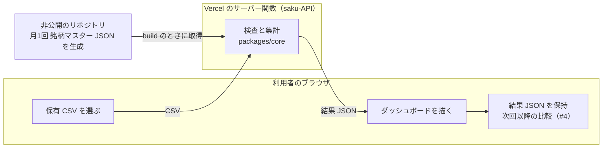
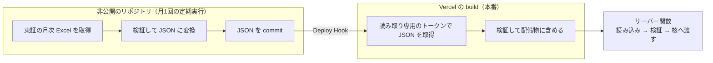
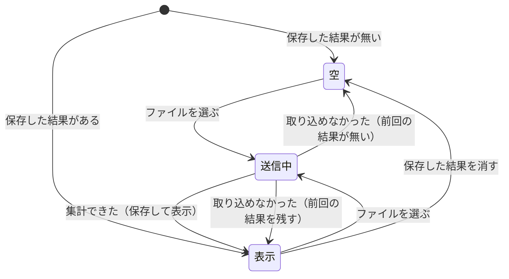

# 設計

この文書は、sakuforge の純粋関数の境界、パッケージ構成、銘柄マスター JSON の流れ、層ごとの守りの分担の設計の正本です。判断は
ADR 0003（言語は TypeScript）と ADR 0004（Vercel と Next.js、検査と集計はサーバー関数）にあり、ここでは
それを形にします。規則（上限値、所見 code、構成計算）は[ドメイン規則](domain-rules.md)を正本とし、
ここに再掲しません。上限値だけは、5 節で Vercel の上限と比べるために写します。

## 1. 全体の流れ



ブラウザは CSV をサーバー関数へ送り、関数は核で検査と集計をして結果を JSON で返します。サーバーは CSV も
結果も保存しません。銘柄マスターは関数の中だけで使い、ブラウザへ配りません（ADR 0004）。招待の確認は
ありません（[ADR 0006](decisions/0006-unlisted-public-release.md)）。

## 2. 純粋関数の境界

核（`packages/core`）は、入力だけから結果が決まり、保存・通信・時計・乱数・ログを持たない関数だけを置きます。

| | 内容 |
| --- | --- |
| 入力 | CSV のバイト列（`Uint8Array`）または decode 済みの文字列と、銘柄マスター（検証済みの値）。大きさの上限は、バイト列は byte 数、文字列は長さ（UTF-16 の符号単位の数）で数える |
| 出力 | 検査結果（`valid`、件数、所見、照合結果）と集計結果。検査結果の形と構成計算の規則は[ドメイン規則](domain-rules.md)の6・7節。集計結果の項目は ADR 0005 の「流れ」の3、JSON の形は[8](#8-要求応答保存する-json-の形) |
| 10進 | 金額・株数・構成比は文字列で受け渡し、核の中でも2進浮動小数点（`number`）で計算しない |
| 例外 | 利用者向けの結果は固定 code と固定 message だけにする。例外の文字列を結果に入れない（[入力を信用しない原則](input-trust-principles.md)） |

decode（UTF-8 と CP932）は核の中に置きます。`TextDecoder` は Node.js にもブラウザにもある標準の機能で、
副作用を持たないので、核のテストで文字コードの規則まで確かめられます。核をブラウザ側へ移す保険の案
（ADR 0004 の「検討した他の案」）でも、そのまま動きます。

核の外（`apps/web` のサーバー関数）に残るもの:

- リクエストの受け取りと、サイズ上限+1 byte までの読み込み
- 実行時間の上限。独自の時計は持たず、関数全体の `maxDuration` に任せる（[5](#5-vercel-の関数で処理するときの上限)）
- 銘柄マスター JSON の読み込みと検証（[外部データとの約束](external-data-policy.md)）
- 結果 JSON への変換と、出典・基準日の付加
- ログに内容を出さないこと（成否、件数、処理時間、固定 code だけ）

## 3. パッケージ構成

pnpm workspace は次の2つのパッケージで構成します。

| パッケージ | 中身 | 依存してよいもの |
| --- | --- | --- |
| `@sakuforge/core`（`packages/core`） | CSV の検査、集計、型 | 10進演算と入力検証の最小限の依存だけ。React、Next.js、実行環境固有の API に依存しない |
| `@sakuforge/web`（`apps/web`） | Next.js（App Router）の画面と、サーバー関数（検査と集計） | `@sakuforge/core` |

銘柄マスター JSON を生成する道具（取得と変換のスクリプト、定期実行の設定）は、非公開のリポジトリに置き、
このリポジトリには置きません（[4](#4-銘柄マスター-json-の流れ)）。東証の Excel を読む依存を、公開するアプリの
lockfile に入れないためです。`.gitignore` の `data/stock-master/` は、build のときに取得した JSON の置き場で、
リポジトリに入れません。

## 4. 銘柄マスター JSON の流れ

本物の銘柄マスターを用意して配備物に含めるまでの計画です（#66、2026-11-11）。JSON は配備物に含め、
実行時に DB や外部の保存先を読みません。例の値はすべて合成データです。

### 4.1 流れ



1. 月1回、非公開のリポジトリの定期実行が、東証の月次 Excel を取得・検証し、必要な列だけの JSON を生成して
   commit する（[外部データとの約束](external-data-policy.md)の2節）。続けて Vercel の Deploy Hook を呼ぶ
2. Vercel の build は、始める前に読み取り専用のトークンで非公開のリポジトリから JSON を取り、検証してから
   配備物に含める
3. サーバー関数は、配備物の JSON を読み、信用せずに検証してから核へ渡す。ブラウザへは配らない
   （[ADR 0004](decisions/0004-vercel-nextjs-server-side.md)）

JSON と生成の道具は非公開のリポジトリに置き、このリポジトリには置きません（[ADR 0002](decisions/0002-public-repository.md)）。
非公開のリポジトリの名前と URL は、文書・Issue・PR に書きません。元の Excel は保存せず、変換したら捨てます。

### 4.2 JSON の項目

```json
{
  "schemaVersion": 1,
  "asOf": "2026-10-31",
  "fetchedAt": "2026-11-05T00:00:00Z",
  "sourceSha256": "0000000000000000000000000000000000000000000000000000000000000000",
  "stocks": [
    {
      "code": "9A9A",
      "sector17": { "code": "1", "name": "合成業種1" },
      "sector33": { "code": "50", "name": "合成業種50" }
    },
    { "code": "9C9C", "sector17": null, "sector33": null }
  ]
}
```

| 項目 | 内容 |
| --- | --- |
| `schemaVersion` | JSON の版。整数。今は 1 |
| `asOf` | 基準日。月末の日付（`YYYY-MM-DD`）。取得日時と分けて持つ |
| `fetchedAt` | 取得日時 |
| `sourceSha256` | 元の Excel の SHA-256。Excel を保存しない代わりに、どのファイルから作ったかを残す |
| `stocks` | 銘柄ごとの 証券コード、17 業種の code と name、33 業種の code と name。業種が無い銘柄は `null` |

- 会社名は入れない。照合と構成計算に要る項目だけにする（[外部データとの約束](external-data-policy.md)の2節）
- 業種の一覧（保有の無い業種を出すためのもの。[ドメイン規則](domain-rules.md)の7節）は、`stocks` に出てくる業種から
  作る。JSON に業種の一覧を別には持たない
- 33 業種の code は、東証の一覧の値を、先頭にゼロを足さず数字の文字列で持つ（`"50"`、`"1050"`）。核は数値として
  並べるので、表記で結果は変わらない
- `stocks` は配列にする。証券コードを key にした object は、同じ key が重なっても読み込みで気づけないため
- 応答に付ける出典と基準日（[8](#8-要求応答保存する-json-の形)の `stockMaster`）は、この `asOf` から作る

### 4.3 検証

生成のとき（非公開のリポジトリ）と、読み込むとき（build とサーバー関数）の両方で、同じ項目を確かめます。

- 版が知っている値である
- 件数が下限と上限の中にある
- 証券コードが[ドメイン規則](domain-rules.md)の3節の形式で、重複が無い
- 17 業種の code が 1〜17、33 業種の code が 1〜4 桁の数字で 33 種類以内
- 同じ code には同じ name が付いている
- name が文字数の上限以内で、制御文字を含まない
- 基準日が実在する過去の日付である

件数は 1,000 件以上 20,000 件以下、name は 100 文字以下とします（#85、2026-11-12）。合成の銘柄マスターは 2 銘柄なので、
件数の下限だけを 1 に下げて読みます。

### 4.4 失敗したときの動き

| 場所 | 失敗したとき | 残るもの |
| --- | --- | --- |
| 生成（非公開のリポジトリ） | JSON を置かず、Deploy Hook も呼ばない。定期実行の失敗の通知で気づく | 前の JSON と前の配備 |
| build（Vercel） | 取得か検証に失敗したら、build を失敗させる | 前の配備 |
| サーバー関数 | 固定の code（`internal_error`）で拒否する。集計を返さない | — |

基準日が古くても止めません。画面に出典と基準日を表示します。古さを理由に止めると、東証の公開が遅れた月に
使えなくなるためです。

### 4.5 環境ごとの銘柄マスター

| 環境 | 銘柄マスター |
| --- | --- |
| 本番（Vercel の Production） | 本物 |
| Preview、手元、CI | 合成（`apps/web/src/server/synthetic-stock-master.ts`）。本物を渡さない |

### 4.6 秘密

- 非公開のリポジトリを読むトークンは、Vercel の環境変数に置く。1 つのリポジトリの内容を読むだけに絞る
- Deploy Hook の URL は、非公開のリポジトリの secret に置く
- どちらも、リポジトリ・ログ・Issue・PR に書かない。期限と入れ替えの手順は、配備の運用手順に書く（#44 の「3. 載せる」）

## 5. Vercel の関数で処理するときの上限

値は[ドメイン規則](domain-rules.md)の1節が正本で、ここでは決めません。Vercel の関数で
処理すると、ドメイン規則の上限の前に、Vercel 側の上限がかかります。現行の値は #20 で確かめます。

| 上限 | 気にすること |
| --- | --- |
| サイズ 4 MiB、上限+1 byte まで読む | Vercel の関数の本文上限は公式資料で 4.5 MB（2026-11-01 確認、#20）。本文は CSV だけなので（[8.1](#81-要求)）、4 MiB+1 byte まで読んでも収まる。これより大きい本文は関数に届く前に 413 になるので、画面で処理する。送信の実測で扱えなければ、ブラウザで検査する案（ADR 0004 の保険の案）に切り替える |
| データ行 10,000、列 100 | 関数の memory と実行時間の中に収まるか（#20） |
| 検査時間：関数全体の `maxDuration` | 独自の時計を持たない（同期の核は途中で止められないため）。値は Vercel 上の実測で決める（#20）。超えたら Vercel のエラー（504）になり、画面は失敗として扱う |
| 所見 200 件、未知コードは全件（PR #22） | 応答 JSON の大きさを抑える。レスポンス本文にも 4.5 MB の上限がある（#20） |
| ファイル名、MIME タイプ | ファイル名はサーバーへ送らない。`Content-Type` は画面が固定で付ける値で、信用せず、内容検証の代わりにしない（[8.1](#81-要求)）。どちらもログに出さない |
| ログと監視 | CSV の内容、資産値、ファイル名を、関数のログ、エラー、Vercel の監視に出さない（[入力を信用しない原則](input-trust-principles.md)の3節） |

## 6. ブラウザ側の結果と履歴

ブラウザは返ってきた結果 JSON からダッシュボードを描き、次回以降の比較のために保持します。JSON の形は
[8](#8-要求応答保存する-json-の形)です。段階 2 の画面の範囲は、次のとおりです（#67、2026-11-11）。
ダッシュボードの参考例（`references/ui-dashboard/`）と食い違うところは、この節を優先します。

### 6.1 段階 2 の画面に入れる部品

| 部品 | 段階 2 | 内容 |
| --- | --- | --- |
| CSV を選ぶ案内 | 入れる | 保存した結果が無いときに出す（[6.5](#65-状態と移り方)の「空」） |
| 評価額の合計、年間配当見込み（下限〜上限） | 入れる | 数字だけを出す |
| 取り込み日時 | 入れる | 表示している結果を取り込んだ日時（[8.5](#85-ブラウザに保存する-json)の `savedAt`） |
| 業種構成のドーナツ、業種別の横棒、17／33 業種の切替 | 入れる | 規則は[ドメイン規則](domain-rules.md)の7節 |
| 保有していない業種を横棒に点線で出す | 入れる | 応答の `sectors` の、`held` が `false` の行を点線で出す（[8.2](#82-応答検査まで進んだときhttp-200)、[ドメイン規則](domain-rules.md)の7節。#81） |
| 通知の帯 | 入れる | 未知の証券コードは、コードの一覧（開閉式）だけを出す。行番号を持つ所見（検査 NG のとき）は、code ごとの固定 message と行番号の一覧を出す。問題が無ければ帯を出さない |
| 出典と基準日 | 入れる | [外部データとの約束](external-data-policy.md)の3節 |
| 「保存した結果を消す」 | 入れる | [6.2](#62-保存) |
| 「該当行を見る」 | 入れない | 未知の証券コードを行番号と結び付けない（[ドメイン規則](domain-rules.md)の5節） |
| ファイル名 | 入れない | 画面に出さず、保存する JSON にも入れない（[8.5](#85-ブラウザに保存する-json)） |
| 利回り | 入れない | 計算の規則が無い。出すなら、先に[ドメイン規則](domain-rules.md)に足す |
| 「結果 JSON を保存」（ファイルへの書き出し） | 入れない | 最初の範囲は「ブラウザ側に保持する」まで（ADR 0005） |
| 推移グラフ、期間タブ、期間の増減、最高値、取り込み回数 | 入れない | 時系列の比較は最初の範囲に含めない（ADR 0005）。段階 3 の候補（#4） |

### 6.2 保存

- 成功した結果（`aggregated`）を、自動でブラウザに保存する。推移は段階 3 で、保存してある過去の分から描く
- 取り込みに成功するたびに 1 件足す。同じ日に取り込んでも上書きしない（同じ日の点の見せ方は、段階 3 で決める）
- ページを開いたときは、保存した結果のうち最新の 1 件を表示する。過去の分の表示は段階 3（#4）
- 保存に失敗しても（容量、ブラウザの設定）、今回の結果は表示し、保存できなかったことを通知する
- 場所は `localStorage` の 1 つのキー。新しい順に最大 200 件を持ち、超えたら古いものから消す
- 形と版は [8.5](#85-ブラウザに保存する-json)・[8.6](#86-版)
- 画面に「保存した結果を消す」を置く
- 保存した結果は、別の端末・別のブラウザでは見えない。そのことを画面に書く

### 6.3 対応ブラウザ

- PC の Chrome・Edge・Safari・Firefox の最新版と 1 つ前の版
- スマートフォン（iOS の Safari、Android の Chrome の最新版）は、縦に積んで崩れずに読めるところまで
- 1440×900 で縦スクロールを出さないことは、PC の基準にする
- 古いブラウザのための分岐は持たない

### 6.4 作り方

- 書体は Noto Sans JP をアプリに同梱し、実行時に外部へ読みに行かない。同梱の方法は実装のときに決める。
  書体のライセンスの表示は #73 で扱う
- 図（ドーナツ、横棒）は、まず SVG と CSS で描く。足りない場合は図表のライブラリを使ってよいが、信頼度の高い
  ものに限る（[入力を信用しない原則](input-trust-principles.md)の6節の採用基準を満たすこと）。依存を足すので、
  採用のときに本人の承認を得る。どのライブラリにするかは、要ると分かった時点で候補を比べて決める

### 6.5 状態と移り方

ページは 1 つで、ダッシュボードを家にします（#101、2026-11-12）。CSV の取り込みはダッシュボードの中の操作で、
取り込むとその場で表示が更新されます。段階 3 で推移を足すときに、骨組みを変えないためです。



| 状態 | 画面 |
| --- | --- |
| 空 | 表示できる保存した結果が無い。「CSV を選ぶ」の案内（何をするサービスか、サーバーに保存しないこと、ファイルを選ぶ操作）を出す。表示できない保存分（読めない形、知らない版）が残っているときは、そのことと「保存した結果を消す」も出す |
| 表示 | 保存した結果のうち最新の 1 件のダッシュボード（[6.1](#61-段階-2-の画面に入れる部品)の部品）と、「CSV を取り込む」「保存した結果を消す」を出す |
| 送信中 | 直前の画面（空か表示）を残したまま、取り込みの操作を止めて、進行中であることを示す。同時にもう 1 件は送らせない |

通知の帯は状態ではなく、空・表示の上に重ねて出します。次の取り込みを始めたときか、閉じる操作で消えます。

| きっかけ | 移り先 | 行うこと |
| --- | --- | --- |
| ページを開く | 保存した結果があれば表示、無ければ空 | 知らない版と形の合わない保存分は表示に使わず、消さない（[8.6](#86-版)） |
| ファイルを選ぶ | 送る前の確認で止まれば元の状態と通知、通れば送信中 | 送る前の確認は、ファイル名の規則（[ドメイン規則](domain-rules.md)の1節）と大きさ 4 MiB。使い勝手のための確認で、守りにはしない |
| 応答が `aggregated` | 表示（今回の結果） | 保存に 1 件足す。未知の証券コードがあれば、注意の帯にコードの一覧を出す |
| 応答が `inspection_failed` | 元の状態（前回の結果か空）と、検査 NG の帯 | 保存しない。所見の固定 message と、行番号の一覧を出す |
| 応答が `error`（[8.3](#83-応答検査へ進めなかったときhttp-4xx5xx)） | 元の状態と、失敗の帯 | 保存しない。応答の固定 message を出す |
| 基盤が返す 413・504、通信の切断、形の合わない応答、知らない `schemaVersion` | 元の状態と、失敗の帯 | 保存しない。画面が持つ固定の文言を出す。応答の中身は表示しない（[7](#7-層ごとの守りの分担)の 5 行目） |
| 「保存した結果を消す」 | 確認の後、空。消せなかったら元の状態と通知 | 保存したものをすべて消す |
| 保存に失敗する | 表示（今回の結果） | 結果は表示し、注意の帯で保存できなかったことを伝える |

- 検査 NG や失敗のときは、前回の結果を残します。取り込めなかった CSV で、正しい結果を消さないためです
- 複数のタブで同時に開いたときは、後から保存したほうが残ります。特別な扱いはしません

画面が持つ固定の文言（応答の message とは別に、画面が用意するもの）:

| 場面 | 文言 |
| --- | --- |
| 空の案内 | 証券会社から書き出した国内株式（現物）の保有資産CSVを選ぶと、評価額の合計、年間配当見込み、業種の構成を表示します。CSVと結果はサーバーに保存しません。 |
| 保存の説明 | 結果はこのブラウザにだけ保存します。別の端末や別のブラウザでは表示されません。 |
| 送る前の確認：ファイル名 | CSVファイル（.csv）を選んでください。 |
| 送る前の確認：大きさ | CSVが大きすぎます。4 MiB以下のファイルを選んでください。 |
| 検査 NG の帯の見出し | 今回のCSVは取り込めませんでした。次の点を直して、もう一度選んでください。 |
| 基盤の 413 | CSVが大きすぎます。4 MiB以下のファイルを選んでください。 |
| 基盤の 504 | 時間内に処理できませんでした。時間をおいて再度お試しください。 |
| 通信の切断 | 通信できませんでした。接続を確かめて、もう一度お試しください。 |
| 形の合わない応答、知らない版 | 処理できませんでした。ページを再読み込みして、もう一度お試しください。 |
| 保存の失敗 | 結果をこのブラウザに保存できませんでした。表示している結果は、ページを閉じると消えます。 |
| 消す前の確認 | このブラウザに保存した結果をすべて消します。元に戻せません。 |
| 表示できない保存分が残っているとき（空の状態） | このブラウザに、この版では表示できない保存分が残っています。 |
| 消せなかったとき | 保存した結果を消せませんでした。ブラウザの設定を確かめてください。 |

## 7. 層ごとの守りの分担

守る対象ごとに、どの層が主に受け持ち、どの層が安全網になるかを決めます（#48、2026-11-07）。ここには
受け持ちだけを書き、規則の中身は右端の正本に書きます。「—」の層は、その対象を受け持ちません。

| 守る対象 | Vercel（基盤） | サーバー関数 | 核（`packages/core`） | 画面 | 開発者（生成・配備・運用） | 規則の正本 |
| --- | --- | --- | --- | --- | --- | --- |
| 1. 要求が続くことによる資源・無料枠の枯渇 | 主：基盤の DDoS 対策と、検査 API への WAF のレート制限 | — | — | — | 安全網：使用量を確かめる手順と、手で止める・戻す手順 | — |
| 2. 1 回の要求による時間・メモリの使いすぎ | 安全網：本文 4.5 MB 超の 413、`maxDuration`、メモリの上限 | 主：上限+1 byte までしか読まず、核へバイト列で渡す | 主：処理量を入力の長さより膨らませず、行・列・所見の上限で止める。時計は持たない | — | 安全網：`maxDuration` の値を実測で決めて設定する（#20） | [ドメイン規則](domain-rules.md)の1節、[入力を信用しない原則](input-trust-principles.md)の2節 |
| 3. 利用者データ・秘密・銘柄マスターの意図しない保存・流出 | — | 主：CSV と結果を残さず、ログは安全な項目だけにし、応答に `Cache-Control: no-store` を付け、銘柄マスターを応答に含めない | 主：戻り値に保有明細・セルの値・CSV の原文・例外の文言を含めない | 主：結果を外部へ送らず、ファイル名をサーバーへ送らない | 安全網：秘密と銘柄マスターをリポジトリと配布物に入れず、配備のときに残るものを確かめる | [入力を信用しない原則](input-trust-principles.md)の3節、[外部データとの約束](external-data-policy.md)の4節 |
| 4. 壊れた銘柄マスターや基準日の取り違えによる誤分類 | — | 主：読み込んだ JSON を検証してから核へ渡し、壊れていれば固定の code で拒否する | 安全網：不正な銘柄マスターでは集計を拒否する | 安全網：出典と基準日を表示する | 主：生成のときと build のときに検証し、失敗したら配備しない | [外部データとの約束](external-data-policy.md)の2節・3節、[4](#4-銘柄マスター-json-の流れ) |
| 5. 不正・途中の結果を、正しい集計として表示すること | — | 主：集計は成功したときだけ返し、拒否は固定の code で返す | 主：error が 1 つでもあれば集計しない | 主：完全に成功した応答だけを反映し、413・504・形の合わない応答・通信の切断では表示しない | — | [入力を信用しない原則](input-trust-principles.md)の2節、[ドメイン規則](domain-rules.md)の6節 |
| 6. 外部由来の文字列が画面でコードとして動くこと | — | 安全網：JSON で返し、CSV のセルの値を含めない | — | 主：文字として描画する。安全網：Content-Security-Policy | 安全網：銘柄マスターの名前の文字数と制御文字を検証する | [入力を信用しない原則](input-trust-principles.md)の1節・3節 |

- 1 は、枯渇を軽減し、それでも残る停止は無料のあいだ受け入れる（有料化するとき、または実行環境に課金し始めるときに見直す）。
  独自のレート制限と、そのための保存先は作らない
- 3 で、利用者の環境（ブラウザの拡張機能、端末の共用、ブラウザの同期）は利用者の責務で、どの層も受け持たない
- Vercel の WAF・Pause Project の使える範囲と、ログ・環境変数に残るものは、配備（#44）のときに確かめる
- CSV Formula Injection は 6 に含めない。セルの値を出力する機能を足すときに扱う（[入力を信用しない原則](input-trust-principles.md)の5節）

## 8. 要求・応答・保存する JSON の形

検査 API の要求と応答、ブラウザに保存する JSON の形を決めます（#21、2026-11-11）。核の戻り値はそのまま
流さず、サーバー関数で組み直します（[2](#2-純粋関数の境界)の「結果 JSON への変換」）。例の値はすべて合成データです。

### 8.1 要求

- `POST /api/inspect`。本文は CSV のバイト列だけにする。multipart にしない
- `Content-Type` は `text/csv`（`application/vnd.ms-excel` も受ける）。画面が固定で付ける。ブラウザが
  ファイルに付ける種類は端末に依るので、使わない
- ファイル名は送らない（[7](#7-層ごとの守りの分担)の 3 行目）。ファイル名の規則（[ドメイン規則](domain-rules.md)の1節）は、
  画面がファイルを選ばせるときに確かめる

### 8.2 応答（検査まで進んだとき、HTTP 200）

```json
{
  "schemaVersion": 1,
  "result": "aggregated",
  "inspection": {
    "valid": true,
    "profile": "domestic_cash_holdings_v1",
    "encoding": "utf-8",
    "rowsScanned": 3,
    "findings": [
      {
        "code": "stock_code_unknown",
        "severity": "warning",
        "message": "銘柄マスターに無い証券コードがあります。該当銘柄は「未分類」として集計しました。"
      }
    ],
    "errorCount": 0,
    "warningCount": 1,
    "totalCount": 1,
    "returnedCount": 1,
    "truncated": false,
    "stockCodeMatch": { "status": "checked", "unknownCodes": ["9D9D"], "unknownCount": 1 }
  },
  "aggregation": {
    "totalAssetValue": "128100",
    "annualDividend": { "lower": "4011", "upper": "5011" },
    "sector17": {
      "status": "computed",
      "sectors": [
        { "code": "1", "name": "合成業種1", "ratio": "93.68", "held": true },
        { "code": "2", "name": "合成業種2", "ratio": "6.25", "held": true },
        { "code": null, "name": null, "ratio": "0.08", "held": true },
        { "code": "3", "name": "合成業種3", "ratio": "0.00", "held": false }
      ]
    },
    "sector33": {
      "status": "computed",
      "sectors": [
        { "code": "1", "name": "合成業種1", "ratio": "93.68", "held": true },
        { "code": "2", "name": "合成業種2", "ratio": "6.25", "held": true },
        { "code": null, "name": null, "ratio": "0.08", "held": true },
        { "code": "3", "name": "合成業種3", "ratio": "0.00", "held": false }
      ]
    }
  },
  "stockMaster": { "source": "株式会社東京証券取引所「東証上場銘柄一覧」", "asOf": "2026-10-31" }
}
```

| 項目 | 内容 |
| --- | --- |
| `schemaVersion` | 応答の版（[8.6](#86-版)） |
| `result` | `aggregated`（検査 OK。`aggregation` がある）または `inspection_failed`（検査 NG。`aggregation` が無い） |
| `inspection` | 検査結果。項目は[ドメイン規則](domain-rules.md)の6節。位置を持つ所見には `row`、`column`、`field` が付く。`stockCodeMatch.status` は `checked` または `not_checked`（`not_checked` のときは一覧と総数が無い） |
| `aggregation` | 集計結果。規則は[ドメイン規則](domain-rules.md)の7・8節 |
| `stockMaster` | 銘柄マスターの出典（`source`）と基準日（`asOf`）。HTTP 200 の応答に常に付ける。未知の証券コードの一覧も銘柄マスター由来の情報なので、検査 NG のときも要る（[外部データとの約束](external-data-policy.md)の3節） |

- 合計が 0 のときは `aggregated` のまま、`sector17`・`sector33` が `{ "status": "not_computable", "sectors": [] }` に
  なる。検査 NG と区別できる
- 未分類は `code` と `name` が `null`。表示名は画面で付ける
- `sectors` の各行の `held` は、その業種を保有しているかどうか。保有の無い業種は、構成比 `"0.00"`・`held` が
  `false` で、保有のある行の後ろに並ぶ（[ドメイン規則](domain-rules.md)の7節）。丸めて `"0.00"` になった保有のある
  業種とは、`held` で区別する
- 画面は、`held` が `false` の行を横棒に点線で出し、ドーナツには出さない。ドーナツの中央の「保有業種数／
  総業種数」は、分類済み（`code` が `null` でない）の行のうち `held` が `true` の数と、分類済みの行の総数から作る
- 核の内部の印（`kind`）は応答に入れない
- 合成の銘柄マスターで動く環境（[4.5](#45-環境ごとの銘柄マスター)）では、`stockMaster.source` は合成データであることを示す固定文に
  なる。東証の名前を、東証のデータでないものに付けないためです

### 8.3 応答（検査へ進めなかったとき、HTTP 4xx・5xx）

```json
{ "schemaVersion": 1, "error": { "code": "csv_too_large", "message": "CSVが大きすぎます。4 MiB以下のファイルを選んでください。" } }
```

| code | HTTP | 意味 |
| --- | --- | --- |
| `request_body_unreadable` | 400 | 本文を読み取れなかった |
| `csv_too_large` | 413 | 4 MiB を超えた |
| `unsupported_media_type` | 415 | `Content-Type` が受け付ける値でない |
| `csv_too_many_rows` | 422 | データ行が上限を超えた |
| `csv_too_many_columns` | 422 | 列が上限を超えた |
| `internal_error` | 500 | それ以外。壊れた銘柄マスター（核の `invalid_stock_master`）もここにまとめる（利用者に直せないため） |

- message は固定の文言で、例外の文字列、セルの値、ファイル名を含めない
- Vercel が返す 413・504 などは JSON とは限らない。画面は、HTTP 200 で形の合う応答だけを結果として扱う
  （[7](#7-層ごとの守りの分担)の 5 行目）
- すべての応答に `Cache-Control: no-store` を付ける

### 8.4 値の型と桁

| 値 | 形 |
| --- | --- |
| 金額（`totalAssetValue`、`annualDividend.lower`・`upper`） | 丸めない 10 進の文字列。指数表記にしない。末尾のゼロは付けない。最大で整数部 24 桁・小数 8 桁 |
| 構成比（`ratio`） | 小数 2 桁の文字列（`"0.00"`、`"100.00"`） |
| 件数、行番号、列番号 | JSON の数値（整数） |
| 基準日（`asOf`） | `YYYY-MM-DD` の文字列 |

画面の表示では、金額を円未満で四捨五入（half up）し、3 桁区切りにします。文字列のまま処理し、`number` に
変換しません。JSON の値は丸めません。

### 8.5 ブラウザに保存する JSON

```json
{
  "schemaVersion": 1,
  "savedAt": "2026-11-11T09:00:00.000Z",
  "aggregation": {
    "totalAssetValue": "128100",
    "annualDividend": { "lower": "4011", "upper": "5011" },
    "sector17": { "status": "computed", "sectors": [{ "code": "1", "name": "合成業種1", "ratio": "100.00", "held": true }] },
    "sector33": { "status": "computed", "sectors": [{ "code": "1", "name": "合成業種1", "ratio": "100.00", "held": true }] }
  },
  "stockMaster": { "source": "株式会社東京証券取引所「東証上場銘柄一覧」", "asOf": "2026-10-31" },
  "summary": { "rowsScanned": 3, "unknownCount": 1 }
}
```

- 保存するのは、グラフと数字を描くのに要る集計結果だけにする。`aggregated` の結果だけを保存し、検査 NG は
  保存しない
- `aggregation` と `stockMaster` は応答と同じ形
- `summary` は件数だけを持つ（走査した行数と、未知の証券コードの数）
- `savedAt` はブラウザの時計で付ける取り込み日時。CSV の価格がいつの値かは CSV から分からないので、
  「取り込み日時」としてだけ表示する
- 入れないもの：保有明細（API が返さないので、ブラウザは持てない）、所見、未知の証券コードの一覧、ファイル名
- 保存の場所・件数・消し方は [6.2](#62-保存)、保存した結果どうしの比較は #4 で決める

### 8.6 版

- `schemaVersion` は整数で、応答と保存する JSON の両方に付ける。今は 1
- 保存した JSON を読むとき、知らない版と形の合わないものは表示に使わず、消さない
- 版を上げるときは、古い版を読み替える処理を足す
