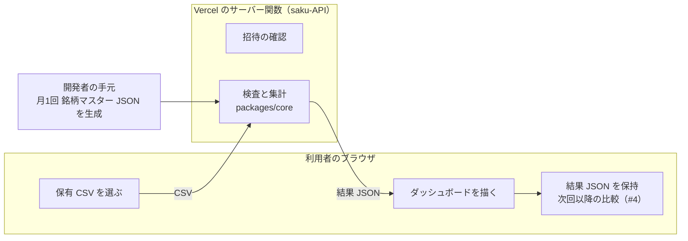

# 設計

この文書は、sakuforge の純粋関数の境界、パッケージ構成、銘柄マスター JSON の流れの設計です。判断は
ADR 0003（言語は TypeScript）と ADR 0004（Vercel と Next.js、検査と集計はサーバー関数）にあり、ここでは
それを形にする案を書きます。規則（上限値、所見 code、構成計算）は[ドメイン規則](domain-rules.md)を正本とし、
ここに再掲しません。名前や構成は案で、実装の PR で確定します。

## 1. 全体の流れ

ブラウザは CSV をサーバー関数へ送り、関数は核で検査と集計をして結果を JSON で返します。サーバーは CSV も
結果も保存しません。銘柄マスターは関数の中だけで使い、ブラウザへ配りません（ADR 0004）。招待の確認の矢印は
省いています。

## 2. 純粋関数の境界

核（`packages/core`）は、入力だけから結果が決まり、保存・通信・時計・乱数・ログを持たない関数だけを置きます。

| | 内容 |
| --- | --- |
| 入力 | CSV のバイト列（`Uint8Array`）または decode 済みの文字列と、銘柄マスター（検証済みの値） |
| 出力 | 検査結果（`valid`、件数、所見、照合結果）と集計結果。検査結果の形と構成計算の規則は[ドメイン規則](domain-rules.md)の6・7節。集計結果の項目は ADR 0001 の「最初の招待で提供する範囲」、JSON の形は #21 |
| 10進 | 金額・株数・構成比は文字列で受け渡し、核の中でも2進浮動小数点（`number`）で計算しない |
| 例外 | 利用者向けの結果は固定 code と固定 message だけにする。例外の文字列を結果に入れない（[入力を信用しない原則](input-trust-principles.md)） |

decode（UTF-8 と CP932）は核の中に置く案です。`TextDecoder` は Node.js にもブラウザにもある標準の機能で、
副作用を持たないので、核のテストで文字コードの規則まで確かめられます。核をブラウザ側へ移す保険の案
（ADR 0004 の「検討した他の案」）でも、そのまま動きます。

核の外（`apps/web` のサーバー関数）に残るもの:

- リクエストの受け取りと、サイズ上限+1 byte までの読み込み
- 検査時間の上限（時計を使うので核の外）
- 招待の確認
- 銘柄マスター JSON の読み込みと検証（[外部データとの約束](external-data-policy.md)）
- 結果 JSON への変換と、出典・基準日の付加
- ログに内容を出さないこと（成否、件数、処理時間、固定 code だけ）

## 3. パッケージ構成の案

pnpm workspace で2つに分けます。

| パッケージ | 中身 | 依存してよいもの |
| --- | --- | --- |
| `packages/core` | CSV の検査、集計、型 | 10進演算と入力検証の最小限の依存だけ。React、Next.js、実行環境固有の API に依存しない |
| `apps/web` | Next.js（App Router）の画面と、サーバー関数（招待の確認、検査と集計） | `packages/core` |

銘柄マスター JSON を生成する手元の道具をリポジトリに置くかどうかは、実装の PR で決めます。置く場合も
生成物は `.gitignore` の `data/stock-master/` に出し、リポジトリに入れません。

## 4. 銘柄マスター JSON の流れ

1. 月1回、手元で東証の月次 Excel を取得・検証し、必要な列だけの JSON を生成する（[外部データとの約束](external-data-policy.md)の2節）
2. 生成物はリポジトリの外に置く（[ADR 0002](decisions/0002-public-repository.md)）
3. サーバー関数がそれを読み、照合と集計に使う。ブラウザへは配らない。関数へどう置くか（配備物に含めるか、
   Vercel の外部の保存先から読むか）は実装の前に決める。利用範囲の確認は #3
4. 関数は読み込んだ JSON を信用せず、形式と件数を検証してから核へ渡す

## 5. Vercel の関数で処理するときの上限

値は[ドメイン規則](domain-rules.md)の1節が正本で、ここでは決めません（#9 で決める）。Vercel の関数で
処理すると、ドメイン規則の上限の前に、Vercel 側の上限がかかります。現行の値は #20 で確かめます。

| 上限 | 気にすること |
| --- | --- |
| サイズ 10 MiB、上限+1 byte まで読む | Vercel の関数のリクエスト本文の上限が、10 MiB より小さい可能性がある（#20）。小さければ、サイズの上限を下げるか、ブラウザで検査する案に切り替える |
| データ行 10,000、列 100 | 関数の memory と実行時間の中に収まるか（#20） |
| 検査時間 5 秒 | 関数の実行時間の上限より短くする。サーバーで測るので、利用者の端末に依らない |
| 所見 200 件、未知コード 50 件 | 応答 JSON の大きさを抑える |
| ファイル名、MIME タイプ | ブラウザが送る値で信用しない。ログに出さない |
| ログと監視 | CSV の内容、資産値、ファイル名を、関数のログ、エラー、Vercel の監視に出さない（[入力を信用しない原則](input-trust-principles.md)の3節） |

## 6. ブラウザ側の結果と履歴

ブラウザは返ってきた結果 JSON からダッシュボードを描き、次回以降の比較のために保持します。JSON の形は #21、
保存の場所と比較（時系列の総資産など）は #4 で決めます。比較は最初の範囲には含めません（ADR 0001）。
